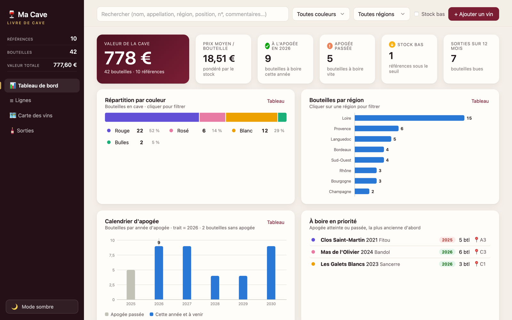
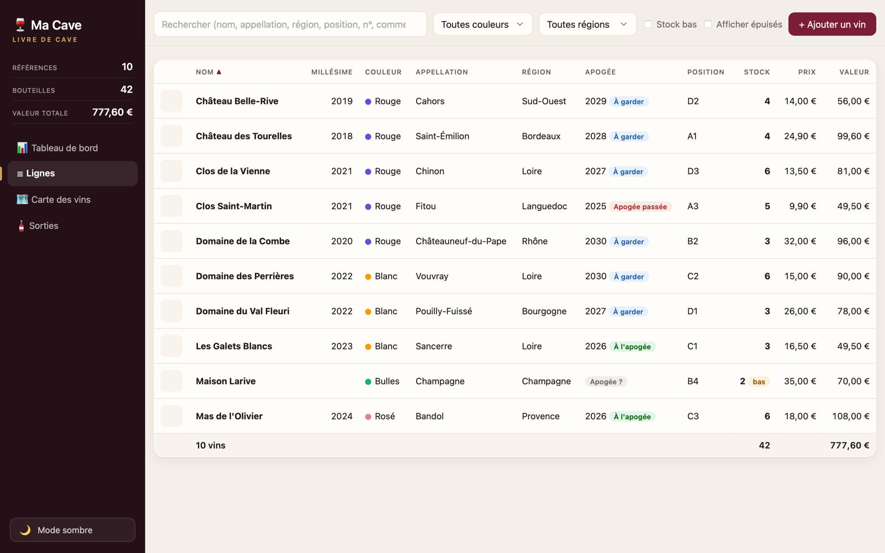
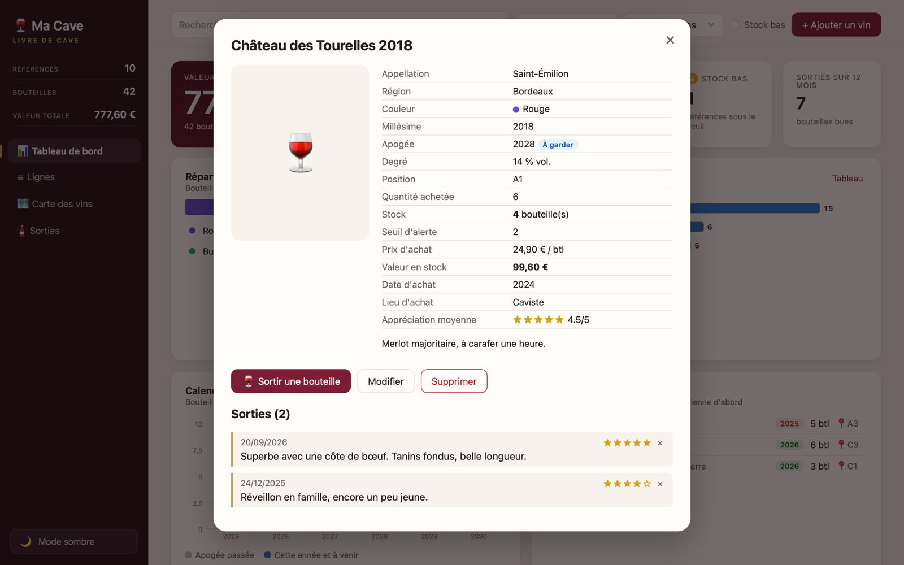
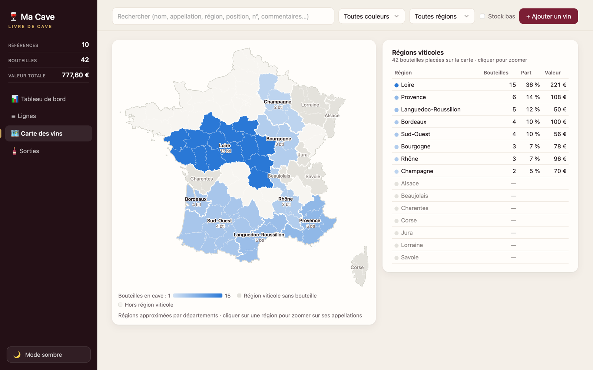
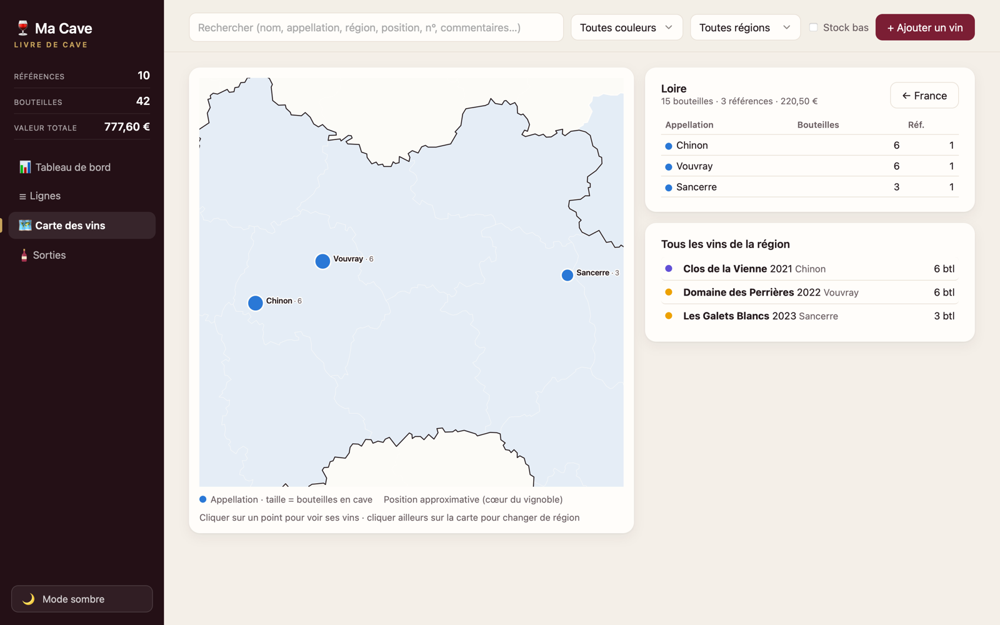
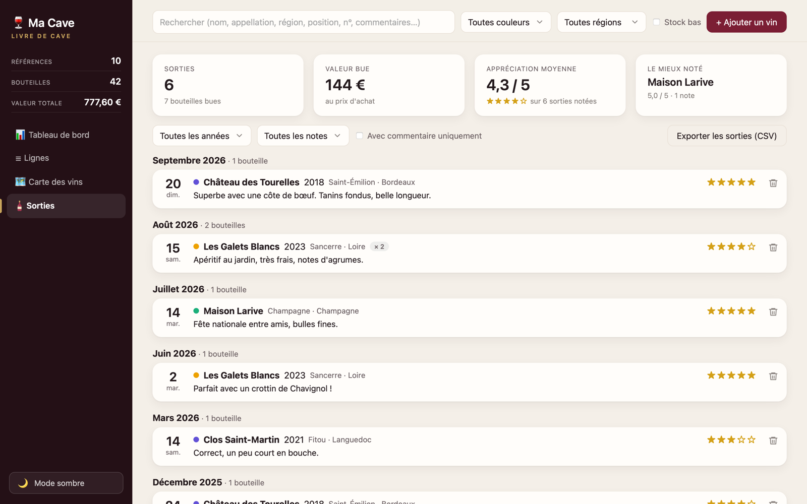
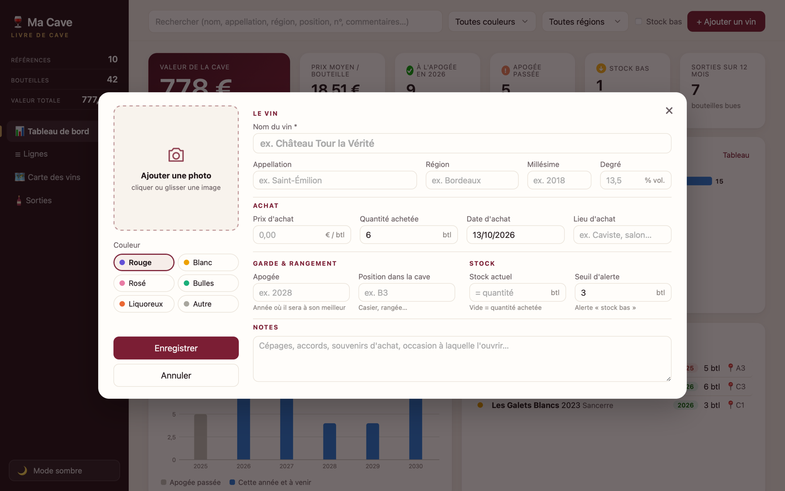
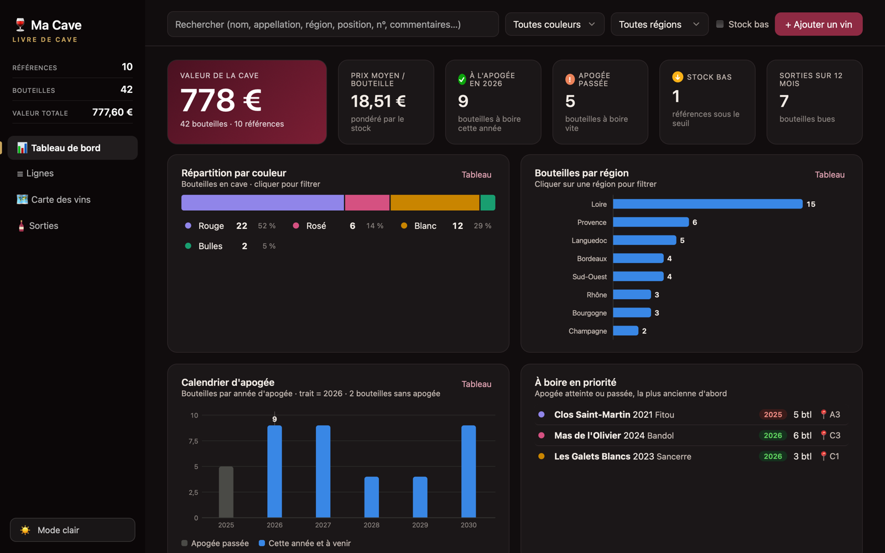

<p align="center">
  
</p>

<h1 align="center">Ma Cave</h1>

<p align="center">
  <b>Le livre de cave qui tient dans un seul fichier.</b><br>
  Gérez vos bouteilles, suivez leur apogée, notez chaque dégustation et visualisez votre cave sur la carte de France.<br>
  Sans installation, sans compte, sans serveur : un double-clic sur <code>index.html</code> et c'est parti.
</p>

<p align="center">
  
</p>

---

## Sommaire

- [Fonctionnalités](#fonctionnalités)
- [Aperçu](#aperçu)
- [Démarrer](#démarrer)
- [Vos données](#vos-données)
- [Sous le capot](#sous-le-capot)
- [Crédits](#crédits)

## Fonctionnalités

| | |
|---|---|
| 🍷 **Fiche complète par vin** | Nom, appellation, région, couleur, millésime, apogée, degré, quantité, stock, prix, lieu et date d'achat, position dans la cave, notes et photo. |
| 📊 **Tableau de bord** | Valeur de la cave, prix moyen, vins à leur apogée, apogée passée, stock bas, et 8 graphiques : couleurs, régions, calendrier d'apogée, millésimes, tranches de prix, vins qui pèsent le plus, lieux d'achat, sorties par mois. |
| ☰ **Vue en lignes** | Tableau compact, tri par colonne, totaux, miniature photo agrandissable d'un clic. |
| 🗺️ **Carte des vins** | Les 15 régions viticoles colorées selon vos bouteilles ; un clic zoome sur la région et place chaque appellation à sa position réelle. |
| 🍾 **Sorties & commentaires** | Chaque bouteille sortie garde sa date, une note sur 5 et un commentaire de dégustation ; le stock se met à jour tout seul. Historique filtrable et exportable en CSV. |
| 🔍 **Recherche intelligente** | Cherche aussi dans les commentaires et les notes, sans tenir compte des accents, avec surlignage des passages trouvés. |
| 🔔 **Alertes** | Badges « À garder », « À l'apogée », « Apogée passée » et « Stock bas » (seuil réglable par vin). |
| 🌙 **Mode clair / sombre** | Interface « Sommelier » aux tons ivoire et bordeaux, couleurs des graphiques vérifiées pour les daltoniens. |

## Aperçu

<table>
  <tr>
    <td width="50%"><p align="center"><sub><b>Vue en lignes</b> — tri par colonne, totaux, badges d'apogée et de stock</sub></p></td>
    <td width="50%"><p align="center"><sub><b>Fiche d'un vin</b> — détails, appréciation moyenne, historique des sorties</sub></p></td>
  </tr>
  <tr>
    <td><p align="center"><sub><b>Carte des vins</b> — les régions colorées selon le nombre de bouteilles</sub></p></td>
    <td><p align="center"><sub><b>Zoom sur une région</b> — chaque appellation à sa position, taille = bouteilles</sub></p></td>
  </tr>
  <tr>
    <td><p align="center"><sub><b>Sorties</b> — dégustations notées et commentées, filtres par année et par note</sub></p></td>
    <td><p align="center"><sub><b>Ajout d'un vin</b> — photo par glisser-déposer, champs regroupés par thème</sub></p></td>
  </tr>
</table>

<p align="center">
  <br>
  <sub><b>Mode sombre</b> — un clic en bas de la barre latérale</sub>
</p>

> Les vins visibles sur les captures sont des exemples (domaines fictifs), fournis avec l'application.

## Démarrer

1. Téléchargez le projet : bouton **Code → Download ZIP**, ou
   ```bash
   git clone https://github.com/pchartie/cave-a-vin.git
   ```
2. Ouvrez **`index.html`** dans votre navigateur (Chrome, Edge, Firefox ou Safari).

C'est tout. Au premier lancement, la cave se remplit avec une dizaine de vins d'exemple pour découvrir l'application ; supprimez-les ou modifiez-les librement.

## Vos données

- **Tout reste sur votre ordinateur.** Les vins, photos et sorties sont enregistrés dans le navigateur (IndexedDB). Rien n'est envoyé sur Internet.
- **Une cave par navigateur.** Chrome et Firefox, par exemple, ont chacun leur propre cave.
- ⚠️ **Effacer les données de navigation efface la cave.** Pensez-y avant un grand ménage.

### Partir de votre propre liste

Les vins chargés au premier lancement viennent de **`donnees-initiales.js`**. Remplacez son contenu par vos vins, dans ce format :

```js
window.DONNEES_INITIALES = {
  version: 1,
  vins: [
    {
      id: "v-001",                 // identifiant unique
      nom: "Château Exemple",
      appellation: "Saint-Émilion",
      region: "Bordeaux",          // Bordeaux, Loire, Rhône, Bourgogne, Languedoc…
      couleur: "Rouge",            // Rouge, Blanc, Rosé, Bulles, Liquoreux, Autre
      millesime: 2018,
      apogee: 2028,                // année où le vin sera à son meilleur
      degre: 14,
      quantite: 6,                 // bouteilles achetées
      stock: 6,                    // bouteilles encore en cave
      prix: 24.9,                  // prix d'achat par bouteille
      lieuAchat: "Caviste",
      position: "A1",              // emplacement dans la cave
      seuil: 2,                    // alerte « stock bas »
      dateAchat: "2024",
      notes: "",
      photo: null,
      sorties: []
    }
  ]
};
```

L'import n'a lieu qu'une fois par navigateur (au premier lancement) : il n'écrase jamais une cave déjà remplie.

## Sous le capot

- **HTML, CSS et JavaScript « à la main »**, sans framework, sans dépendance, sans étape de compilation : tout tient dans `index.html` (~150 Ko).
- **Graphiques en SVG** dessinés par le code, avec infobulles et vue « Tableau » pour chaque graphique.
- **Carte** : contours des départements simplifiés et regroupés en régions viticoles (`carte-france.js`), environ 200 appellations positionnées à la main.
- **Fonctionne hors ligne** : aucune ressource externe n'est chargée.

```
cave-a-vin/
├── index.html            l'application complète
├── carte-france.js       contours de la France et des régions viticoles
├── donnees-initiales.js  vins chargés au premier lancement (exemples)
├── favicon.svg, favicon-32.png, apple-touch-icon.png
└── captures/             images de ce README
```

## Crédits

- Contours des départements : [france-geojson](https://github.com/gregoiredavid/france-geojson) de Grégoire David (données IGN / INSEE), simplifiés pour l'application.
- Les régions viticoles sont approximées par départements entiers, et les appellations placées au cœur de leur vignoble : la carte est indicative.

---

<p align="center"><sub>Fait avec ❤️ et quelques bonnes bouteilles.</sub></p>
